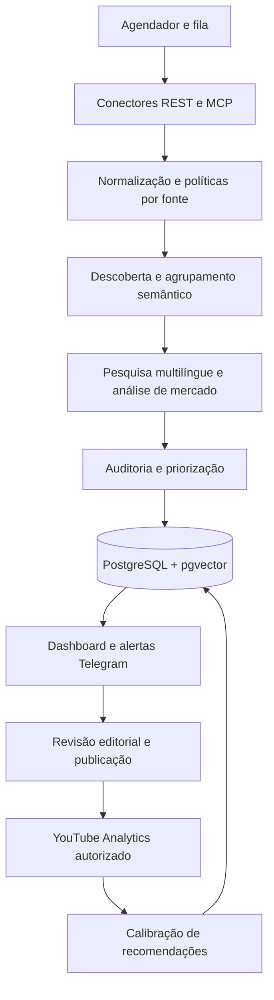

# Content Radar
## Plano de implementação e validação comercial — v2.0

**Data:** 24/11/2026  
**Status:** proposta para execução  
**Objetivo:** construir uma operação internacional de conteúdo original no YouTube, apoiada por uma plataforma própria de inteligência editorial.

## 1. Diretriz de investimento

Priorizar o benefício e o retorno esperado de cada investimento, utilizando recursos tecnológicos e comerciais que aumentem a qualidade das decisões e dos vídeos. Não minimizar custos como objetivo principal, nem contratar capacidade ociosa ou financiar indefinidamente hipóteses não validadas. Adequar orçamento, complexidade e escala à maturidade de cada fase.

A plataforma é um meio; o negócio inicial é a receita dos canais. O desenvolvimento de um SaaS comercial fica fora do escopo. A hipótese central é que a descoberta sistemática de oportunidades entre mercados linguísticos melhora a escolha de pautas e o retorno por vídeo. Ela ainda não está comprovada.

## 2. Estratégia editorial e internacional

- Usar conteúdos estrangeiros como sinais de demanda, não como material a copiar. Produzir roteiros, narração e elementos visuais originais ou devidamente licenciados.
- Avaliar qualquer par origem–destino, sem privilegiar português ou inglês automaticamente. Distinguir idioma, país e público efetivo.
- Começar com dois grupos editoriais: ciência/tecnologia/engenharia e história/civilizações/curiosidades. Investigar outros nichos sem abrir canais prematuramente.
- Criar uma conta Google dedicada ao estúdio e até dois canais temáticos. Ativar o segundo quando houver capacidade editorial e pautas suficientes. Não criar um canal por idioma inicialmente; usar faixas de áudio e metadados localizados quando disponíveis e adequados. Separar canais por mercado somente se evidências indicarem necessidade.
- Priorizar vídeos longos de 8–15 minutos, quando o assunto justificar, e testar Shorts como descoberta complementar, sem pressupor o mesmo RPM.
- Revisão humana obrigatória de precisão factual, direitos, pronúncia, naturalidade cultural, narrativa e qualidade visual antes de publicar.

## 3. Plano de execução e orçamento por fase

Valores em reais, incluindo pesquisa, tecnologia e produção audiovisual, mas excluindo remuneração do proprietário, impostos sobre lucro e desenvolvimento terceirizado. São tetos de autorização, não compromissos de gasto. Usar câmbio de planejamento de R$ 6/US$, revisar no pagamento. As fases começam no início do projeto; a expansão depende de resultados, não apenas do calendário.

| Fase | Prazo indicativo | Inteligência/infra | Produção | Reserva | Teto total |
|---|---|---:|---:|---:|---:|
| 0 — Viabilidade técnica | Semanas 1–2 | 800 | 0 | 200 | 1.000 |
| 1 — MVP e piloto | Restante dos meses 1–3 | 3.000 | 9.000 | 2.000 | 14.000 |
| 2 — Validação de audiência | Meses 4–6 | 4.500 | 9.000 | 1.500 | 15.000 |
| 3 — Crescimento | Meses 7–12 | 9.000 | 18.000 | 3.000 | 30.000 |
| 4 — Escala | Ano 2 | Conforme retorno | Conforme retorno | Conforme caixa | Nova decisão |

**Limite inicial:** R$ 15.000 nos primeiros três meses, dos quais R$ 1.000 para viabilidade técnica. Limite condicional acumulado: R$ 30.000 em seis meses e R$ 60.000 em doze meses. Não comprometer o orçamento anual antecipadamente. A reserva não é gasto obrigatório; despesas efetivas e receitas devem ser acompanhadas separadamente.

### Fase 0 — Provar que as fontes funcionam

Testar credenciais, cobertura por idioma, qualidade das buscas, custo por operação, condições de licença e possibilidade de uso automatizado no backend. Executar uma amostra de 30 assuntos em 4–6 idiomas e comparar os dois fornecedores especializados, utilizando os mesmos critérios. Registrar fontes, relevância, resultados exclusivos e falsos positivos. Fazer uma prova simples de ponta a ponta, sem investir em interface sofisticada.

**Saída:** pelo menos uma fonte especializada utilizável, evidências suficientes para construir dossiês e caminho de conformidade definido. Se nenhuma fonte oferecer cobertura adequada ou uso permitido, rever o método antes de avançar. Aprovações pendentes não autorizam uso restrito.

### Fase 1 — MVP e piloto editorial

Implementar coleta, pesquisa multilíngue, ranking autorizado, dossiês, painel e registro de decisões. Validar manualmente 30 oportunidades e publicar 20–30 vídeos originais como alvo de trabalho, ajustando volume à qualidade e ao custo real (R$ 9 mil de produção comportam, por exemplo, 30 vídeos a R$ 300 ou 20 a R$ 450). Começar com um canal, ativando o segundo conforme capacidade. Testar formatos e idiomas, incluindo um grupo de comparação editorial convencional.

**Saída:** pipeline repetível, recomendações verificáveis, primeiros sinais de impressões, CTR, retenção e audiência; pelo menos 70% dos dossiês da amostra considerados úteis pelo revisor, como meta interna inicial. Sem sinais editoriais, ajustar narrativa, formato e seleção antes de aumentar o volume.

### Fase 2 — Validar audiência e monetização

Publicar regularmente, testar localização e aprimorar roteiros e thumbnails. Integrar Analytics dos canais próprios. Objetivo: pelo menos um canal monetizado ou trajetória demonstrável em direção à elegibilidade, crescimento orgânico e identificação de um formato replicável. Não exigir lucro imediato; exigir evidências de progresso e custos unitários conhecidos. Se não houver sinais após testes suficientes, pausar expansão e revisar a hipótese.

### Fase 3 — Demonstrar economia unitária

Ampliar os formatos aprovados, não simplesmente o número de canais. Testar novos mercados e aumentar frequência onde houver capacidade e demanda. Buscar aproximação do equilíbrio operacional, crescimento da receita do catálogo e evidência de que recomendações do radar superam a seleção convencional. Investir em melhoria audiovisual quando ela tiver maior retorno esperado que novos recursos analíticos.

### Fase 4 — Escalar com receita e evidências

Abrir novos canais ou contratar capacidade adicional somente após comprovação de qualidade, repetibilidade e margem de contribuição positiva. Meta indicativa: R$ 5 mil/mês de lucro recorrente como bom resultado inicial; R$ 15 mil como objetivo ambicioso para 24 meses. Não construir projeções de retorno como se fossem receita contratada.

## 4. Ferramentas, contratações e custos

Preços em dólares consultados em 24/11/2026, sujeitos a checkout, região, tributos, licenças e alterações. Valores de consumo são propostas de orçamento, não mensalidades. Não assinar planos anuais antes de testar a integração.

| Serviço | Recomendação inicial | Custo de referência | Decisão de expansão |
|---|---|---:|---|
| YouTube Data API | Ativar | Gratuita dentro das cotas | Solicitar cotas adicionais conforme necessidade e conformidade |
| YouTube Analytics API | Ativar para canais próprios | Sem tarifa de API prevista | Integrar quando houver vídeos publicados |
| vidIQ | Testar Free/MCP; contratar MAX mensal se útil | US$ 49/mês; anual US$ 468 (equivalente a US$ 39/mês) | Aumentar créditos se cobertura e resultados justificarem; avaliar anual depois |
| OutlierKit | Benchmark Hobby ou Pro por um mês; Pro se necessário para teste suficiente | Hobby US$ 49; Pro US$ 99; Max US$ 399/mês | Manter somente se acrescentar cobertura/qualidade; Max mediante demanda comprovada |
| DataForSEO | Crédito por consumo para Trends e pesquisa | Planejar US$ 20–40/mês inicialmente | Expandir por demanda; conferir depósito mínimo e preços por endpoint |
| Google Trends API Alpha | Solicitar acesso | Sem custo assumido; acesso não garantido | Usar DataForSEO enquanto pendente |
| OpenAI API | Contratar desde o início | Planejar US$ 50–100/mês no MVP | Aumentar para US$ 150–300+ conforme volume, qualidade e retorno |
| VPS Orion | Reutilizar | Sem incremento imediato | Separar worker/banco se necessário |
| Backups, domínio e monitoramento | Configurar | US$ 10–20/mês de provisão | Ajustar conforme uso |
| ElevenLabs ou alternativa TTS | Teste na fase editorial | US$ 20–100/mês de provisão | Escolher por naturalidade, idiomas, licença e minutos efetivos |
| Geração audiovisual, banco de mídia e edição | Testar por vídeo | Incluído na verba de produção | Contratar por necessidade de formato, qualidade e licença |

**Combinação típica após benchmark:** vidIQ MAX (49) + DataForSEO (30) + OpenAI (70) + infraestrutura (15) = US$ 164/mês (~R$ 984). Com OutlierKit Pro em paralelo: US$ 263 (~R$ 1.578). Durante o piloto, a segunda assinatura deve ser temporária se exceder a verba de inteligência. Na fase 0, usar testes gratuitos e créditos limitados; se um teste pago completo ultrapassar o teto de R$ 1.000, realocar explicitamente da fase 1 ou aprovar novo limite.

Não contratar Viewstats, 1of10 ou Social Blade inicialmente, pois não demonstramos vantagem incremental nem integração programática adequada. Avaliar em comparação controlada, inclusive para pesquisa editorial manual. Não assumir que todas as funções de interface web estejam disponíveis via API/MCP ou que planos cubram múltiplos canais próprios sem cobrança adicional.

## 5. Escopo do MVP e pesquisa

Configuração inicial sugerida: 6 idiomas (EN, ES, PT, DE, JA, FR), 8 mercados geográficos prioritários (EUA, Reino Unido, Brasil, México, Espanha, Alemanha, Japão e França), 5 nichos, 100–150 canais externos monitorados. Descoberta semanal de canais e diária de pautas. Expandir para coreano, hindi, italiano e indonésio quando a cobertura for comprovada. Alvos de 500 canais, 10 idiomas, 15 países e 20 dossiês/dia são de expansão, não requisitos do MVP.

### Pipeline

1. Descobrir vídeos com desempenho excepcional e tendências a partir de fontes autorizadas; usar buscas direcionadas e canais monitorados.
2. Identificar idioma e assunto central; separar assunto, formato, gancho, contexto local e identidade do criador.
3. Gerar consultas nativas por mercado, buscar equivalentes, comparar embeddings multilíngues e confirmar correspondências ambíguas com LLM.
4. Investigar demanda por sinais independentes: interesse de pesquisa, conteúdo relacionado e tendências; ausência de oferta não prova demanda reprimida.
5. Avaliar concorrência, atualidade, portabilidade cultural, produção e direitos; criar parecer com fontes e alternativas de destino.
6. Priorizar oportunidades, revisar manualmente, publicar e vincular resultados reais às recomendações.

Pesquisa retrospectiva: analisar publicações equivalentes em diferentes idiomas e comparar datas, registrando que a primeira publicação observada não prova origem da tendência. Visualizações acumuladas não provam o momento em que um vídeo viralizou. Pesquisa prospectiva: observações periódicas permitidas, registro da data de descoberta e evolução posterior para testar a hipótese de defasagem entre mercados.

### Pontuação e confiança

| Critério | Peso experimental |
|---|---:|
| Demanda no destino | 25% |
| Lacuna de oferta | 25% |
| Evidência de sucesso na origem | 15% |
| Potencial econômico | 15% |
| Portabilidade cultural | 10% |
| Momento da tendência | 5% |
| Viabilidade de produção | 5% |

Exibir confiança separadamente da nota, com indicação de evidência ausente, data e divergência de fontes. Não preencher dados ausentes com números inventados; não apresentar score alto como prova de sucesso. Direitos e viabilidade legal são filtros eliminatórios. Aplicar métricas derivadas de dados do YouTube apenas se autorizadas; até então, usar indicadores licenciados ou avaliações independentes permitidas, sem usar dados restritos como entrada para contornar a regra. Calibrar pesos após resultados próprios.

## 6. Estratégia de LLMs

Utilizar OpenAI Responses API com roteamento por tarefa, modelos e versões configuráveis. A escolha inicial é baseada em capacidade esperada, não em benchmark já executado. Confirmar disponibilidade na conta e preços antes de fixar os identificadores. Não usar a assinatura pessoal como substituto da API no backend.

| Tarefa | Recomendação |
|---|---|
| Classificação de idioma, nicho e filtros | GPT-6.1 Terra ou modelo equivalente eficiente |
| Extração de conceitos e termos nativos | GPT-6.2 Sol |
| Similaridade entre idiomas | text-embedding-3-large; validação por Sol nos casos ambíguos |
| Análise de concorrência e síntese de evidências | GPT-6.2 Sol |
| Pesquisa aprofundada das melhores oportunidades | GPT-6.2 Astra com busca e ferramentas autorizadas |
| Auditoria de evidências e riscos editoriais | Astra ou segundo modelo independente se benchmark justificar |
| Roteiro e localização cultural | Sol/Astra, com revisão humana e falantes competentes quando necessário |
| Thumbnail e narrativa visual | Modelo multimodal capaz; avaliação humana e testes reais |

Usar Python para deduplicação, agendamento, regras, cálculos permitidos e controle de estados. IA interpreta, formula consultas e avalia evidências; não substitui a coleta de fatos. Saídas estruturadas, schemas versionados, referências e logs. Proteger contra instruções maliciosas em conteúdo externo; nunca permitir que textos pesquisados acionem ferramentas arbitrárias.

Executar benchmark com 30 dossiês, comparar precisão, cobertura, custo, latência e taxa de retrabalho. Usar cache, lote quando adequado e reprocessamento seletivo para evitar pagar pela mesma análise. Não reduzir qualidade para economizar centavos. Acompanhar custo por dossiê aprovado e por pauta publicada. Configurar limites de consumo no próprio backend (alertas de orçamento do provedor podem não bloquear chamadas).

## 7. Arquitetura técnica

| Camada | Escolha inicial |
|---|---|
| Backend | Python + FastAPI, Pydantic, SQLAlchemy, Alembic |
| Frontend | React + TypeScript + Vite, Tailwind/shadcn, ECharts |
| Banco | PostgreSQL + pgvector |
| Agendamento/fila | APScheduler em processo único + fila durável no PostgreSQL; workers com retries e idempotência |
| Conectores | REST, MCP Python SDK; adaptadores independentes por fornecedor |
| IA | Responses API, embeddings, schemas e versões configuráveis |
| Infra | Docker Compose na VPS Orion; Caddy/HTTPS; GitHub privado; backups externos criptografados |
| Observabilidade | Logs estruturados, métricas de custo e erros; Sentry/Langfuse quando úteis, com redação de dados sensíveis |
| Testes | Pytest, testes de contrato dos conectores, Playwright |
| Alertas | Telegram; Hermes opcional, sem depender dele para execução |

Monólito modular com worker separado, sem microserviços. Redis/Celery podem entrar quando concorrência, filas e resiliência justificarem. A VPS de 2 vCPU/8 GB é uma hipótese razoável para processamento majoritariamente externo, não capacidade comprovada; medir memória, CPU, disco e concorrência com Hermes antes de expandir.

Entidades essenciais: fontes e regras de licença, vídeos, canais, observações permitidas, tópicos, mercados, consultas, evidências, oportunidades, decisões editoriais, publicações, métricas próprias, execuções e custos. Cada registro externo deve identificar procedência, prazo de retenção, data de coleta e permissão de uso. Tokens e chaves fora do código, acesso restrito e rotação de segredos.

## 8. Painel e funcionalidades

| Módulo | MVP | Expansão |
|---|---|---|
| Overview | Oportunidades, confiança, últimas execuções e custos | Tendências e alertas personalizados |
| Discovery | Vídeos de referência e links | Descoberta contínua de novos nichos |
| Market Gaps | Matriz assunto × idioma/mercado | Padrões de defasagem temporal |
| Opportunity Lab | Dossiê, evidências, concorrentes, abordagem e aprovação | Pesquisa profunda sob demanda |
| Editorial Pipeline | Pautas, status, custo, vídeo publicado | Gestão de produção multilíngue |
| My Channels | Métricas autorizadas e ligação com pautas | Comparação de formatos e idiomas |
| Operations/Settings | Fontes, limites, idiomas, jobs e erros | Otimização automatizada de recursos |

Cada dossiê deve responder: qual assunto, por que agora, qual público, quais evidências sustentam a oportunidade, quais concorrentes existem, como diferenciar o vídeo, quais riscos e quais recursos serão necessários. Permitir marcar rejeição e motivo. Não depender de dashboard sofisticado para publicar o primeiro vídeo.

## 9. Validação comercial e indicadores

O teste deve comparar pautas recomendadas pelo radar com pautas selecionadas convencionalmente, em formatos e condições tão semelhantes quanto possível. Distribuir pautas elegíveis entre grupos, equilibrando tema, duração, canal e data; comparar resultados em 7, 30 e 90 dias, evitando selecionar somente os casos bem-sucedidos. Amostras pequenas são exploratórias, não provas causais.

| Indicador | Finalidade |
|---|---|
| Dossiês úteis/aprovados | Precisão editorial da investigação |
| Correspondências multilíngues corretas | Qualidade semântica |
| Evidências exclusivas por fornecedor | Retorno de cada assinatura |
| CTR e impressões | Atratividade e distribuição |
| Retenção e duração média | Qualidade do vídeo |
| Views e receita por vídeo/coorte | Retorno editorial |
| Custo completo por vídeo e por dossiê | Economia unitária |
| Receita a 30/90/180 dias | Vida útil e recuperação do investimento |
| Margem operacional e caixa acumulado | Sustentabilidade |

Usar resultados reais para estimar distribuição de audiência por país, RPM e custo incremental de localização. Não inferir país real de espectadores ou receita de canais concorrentes como fatos conhecidos. Reavaliar ferramentas mensalmente: renovar, expandir ou cancelar com base em contribuição demonstrada. Revisar orçamento ao final de cada fase e manter registro de decisões.

## 10. Cenários financeiros e risco

Receitas consideradas: publicidade e YouTube Premium dos próprios vídeos. Não incluir venda do software, afiliados, patrocínios ou outros negócios. RPM de planejamento em dólares por mil views de vídeos longos; câmbio hipotético R$ 6. Antes dos impostos e sem custo de oportunidade do trabalho próprio.

| Views mensais | RPM US$ 1,50 | RPM US$ 3 | RPM US$ 5 |
|---:|---:|---:|---:|
| 100 mil | R$ 900 | R$ 1.800 | R$ 3.000 |
| 300 mil | R$ 2.700 | R$ 5.400 | R$ 9.000 |
| 500 mil | R$ 4.500 | R$ 9.000 | R$ 15.000 |
| 1 milhão | R$ 9.000 | R$ 18.000 | R$ 30.000 |
| 2 milhões | R$ 18.000 | R$ 36.000 | R$ 60.000 |

Com RPM de US$ 3 e custos de R$ 5 mil/mês, equilíbrio exige aproximadamente 278 mil views/mês; lucro de R$ 5 mil exige 556 mil; lucro de R$ 15 mil exige 1,11 milhão. Com custos de R$ 10 mil, esses limites passam a 556 mil, 833 mil e 1,39 milhão, respectivamente. Receita pode ser zero antes da aprovação para monetização. Catálogo e alcance não garantem receita futura.

### Distribuição subjetiva discutida anteriormente (horizonte de 24 meses)

| Desfecho | Julgamento anterior |
|---|---:|
| Abandono ou prejuízo operacional | 35% |
| Equilíbrio ou lucro inferior a R$ 5 mil/mês | 30% |
| Lucro de R$ 5 mil a menos de R$ 15 mil | 20% |
| Lucro de R$ 15 mil a R$ 50 mil | 12% |
| Lucro superior a R$ 50 mil | 3% |

**Importante:** esses números não são probabilidades calibradas, não derivam de uma amostra comparável e não devem orientar compromissos financeiros como se fossem estatísticas. Os 65% restantes representam equilíbrio ou lucro, não necessariamente lucro estritamente positivo nem recuperação do investimento. Não há base para afirmar que o risco real seja de apenas 35%. O orçamento revisado reduz a exposição financeira e pode melhorar a margem, mas não permite recalcular a probabilidade de sucesso. Reestimar após 50–100 vídeos e dados próprios suficientes, incluindo fracassos e custos acumulados.

## 11. Cronograma de desenvolvimento

| Semana indicativa | Entrega |
|---|---|
| 1 | Contas, credenciais, solicitações Google, teste de fontes |
| 2 | Benchmark e prova de conceito ponta a ponta |
| 3 | Banco, conectores, jobs e pesquisa multilíngue |
| 4 | Dossiês e priorização permitida |
| 5 | Dashboard mínimo, revisão e alertas |
| 6 | Auditoria de qualidade, custos e políticas |
| 7–12 | Piloto editorial, publicação e primeiros resultados |

Estimativa de planejamento, dependente da disponibilidade de desenvolvimento, aprovações e qualidade das integrações. Produção pode começar assim que houver pautas verificadas, antes de concluir toda a aplicação.

## 12. Checklist pessoal — executar nesta sequência

### A. Identidade e acessos

- [ ] 1. Criar uma conta Google dedicada ao estúdio (ou utilizar uma já criada para esse fim). Ativar MFA e recuperação. [Conta Google](https://accounts.google.com/signup)
- [ ] 2. Criar primeiro canal temático no [YouTube](https://www.youtube.com/channel_switcher); reservar identidade do segundo, ativando-o conforme piloto. Verificar recursos avançados e localização no [Studio](https://studio.youtube.com/).
- [ ] 3. Criar projeto `content-radar` no [Google Cloud](https://console.cloud.google.com/).
- [ ] 4. Habilitar [YouTube Data API](https://console.cloud.google.com/apis/library/youtube.googleapis.com) e [YouTube Analytics API](https://console.cloud.google.com/apis/library/youtubeAnalytics.googleapis.com).
- [ ] 5. Gerar [credenciais](https://console.cloud.google.com/apis/credentials): chave restrita para coleta pública; OAuth para dados próprios, com escopos mínimos.
- [ ] 6. Solicitar acesso à [Google Trends API Alpha](https://developers.google.com/search/apis/trends).
- [ ] 7. Revisar políticas do YouTube e preparar solicitação de auditoria/cota e permissão específica para métricas derivadas e retenção ampliada. [Processo de auditoria](https://developers.google.com/youtube/v3/guides/quota_and_compliance_audits). Não aguardar aprovação para construir apenas funções permitidas.

### B. Contratações e testes

- [ ] 8. Criar conta [vidIQ](https://vidiq.com/mcp/) e testar MCP no backend; confirmar autenticação, créditos, cobertura e direitos de armazenamento. Assinar MAX mensal se aprovado no teste.
- [ ] 9. Criar conta [OutlierKit](https://outlierkit.com/app/pricing); confirmar acesso API do plano escolhido, realizar benchmark de um mês dentro do orçamento. Não assumir renovação automática necessária; cancelar se não acrescentar valor.
- [ ] 10. Criar conta [DataForSEO](https://app.dataforseo.com/), confirmar depósito mínimo, endpoints e limites; provisionar US$ 20–40 de consumo mensal.
- [ ] 11. Criar projeto [OpenAI API](https://platform.openai.com/), configurar cobrança, chave de serviço e alertas; iniciar com US$ 50–100 de orçamento mensal.
- [ ] 12. Registrar permissões e respostas comerciais dos fornecedores; confirmar utilização automatizada, retenção, envio a LLMs e uso comercial antes de persistir dados ou criar métricas.

### C. Infraestrutura e construção

- [ ] 13. Criar repositório privado `content-radar` no [GitHub](https://github.com/new).
- [ ] 14. Definir subdomínio, preparar Docker Compose na VPS Orion e verificar recursos livres.
- [ ] 15. Configurar PostgreSQL/pgvector, segredos, backups e HTTPS; criar ambiente de testes.
- [ ] 16. Criar bot Telegram dedicado via [BotFather](https://t.me/BotFather), se alertas forem desejados.
- [ ] 17. Elaborar especificação técnica com schemas, contratos de integração, limites, testes e critérios de aceite.
- [ ] 18. Implementar conectores, benchmark de 30 assuntos e prova ponta a ponta. Aprovar fase 1 somente com fontes adequadas e conformidade.
- [ ] 19. Implementar MVP de coleta, pesquisa, dossiês, revisão e painel; configurar telemetria e limites de gasto.

### D. Operação editorial e evolução

- [ ] 20. Testar TTS, edição, bancos de mídia e geração visual; selecionar ferramentas com licença comercial adequada e calcular custo de um vídeo completo antes de contratar planos maiores.
- [ ] 21. Revisar 30 oportunidades; selecionar pautas experimentais e grupo convencional de comparação.
- [ ] 22. Produzir e publicar 20–30 vídeos dentro da verba do piloto, priorizando qualidade; testar idiomas recomendados pela pesquisa.
- [ ] 23. Integrar métricas autorizadas dos próprios canais e acompanhar elegibilidade para monetização.
- [ ] 24. Ao completar 3 meses, revisar resultados, gastos, fornecedores e autorizar (ou não) a fase 2. Repetir nos meses 6 e 12.
- [ ] 25. Após 50–100 vídeos e dados suficientes, revisar cenários financeiros, score e estratégia de expansão.

## 13. Conformidade e riscos

- YouTube: métricas derivadas e retenção ampliada de dados estatísticos exigem aceitação e aprovação aplicáveis. A política adicional permite até 36 meses para determinados dados e clientes aprovados, não um direito geral. Implementar expiração, exclusão/atualização e controles por fonte. Não acumular histórico proibido enquanto aguarda aprovação.
- Fornecedores: contratos, direitos de armazenamento, redistribuição, uso comercial e envio a terceiros não foram confirmados na prática. A existência de API/MCP não implica licença para qualquer uso.
- Direitos autorais: tradução não transfere direitos; autorização pode não resolver regras de conteúdo reutilizado. Evitar reprodução de roteiros, vídeos, músicas e thumbnails sem base legal. Não baixar transcrições ou mídia de forma incompatível com os termos.
- Monetização: verificar requisitos do YPP e políticas sobre conteúdo repetitivo/inautêntico; não publicar em massa material indiferenciado. IA é ferramenta de produção, não substituto de contribuição editorial.
- Financeiro: orçamento por fase, caixa dedicado, sem compromisso plurianual. Medir custos de desenvolvimento próprio e horas de trabalho mesmo quando não representem desembolso.
- Metodológico: ausência de oferta, outliers e tendências não comprovam causalidade ou demanda futura; estimativas devem preservar incerteza e ser testadas.

## 14. Referências oficiais e comerciais

Consultadas para a revisão de preços e políticas em 24/11/2026; demais links são documentação operacional. Confirmar condições no checkout e na conta antes de contratar.

- [vidIQ — planos](https://vidiq.com/plans/) e [MCP / créditos](https://support.vidiq.com/en/articles/15082430-vidiq-mcp).
- [OutlierKit — planos e preços](https://outlierkit.com/resources/choose-your-plan/) e [API](https://outlierkit.com/api-docs).
- [DataForSEO — preços Google Trends](https://dataforseo.com/pricing/keywords-data/google-trends) e [preços gerais](https://dataforseo.com/pricing).
- [OpenAI — preços](https://developers.openai.com/api/docs/pricing) e [comparação de modelos](https://developers.openai.com/api/docs/models/compare).
- [YouTube — políticas para desenvolvedores](https://developers.google.com/youtube/terms/developer-policies), [métricas derivadas e armazenamento](https://developers.google.com/youtube/terms/derived-metrics-policy), [Data API](https://developers.google.com/youtube/v3), [Analytics API](https://developers.google.com/youtube/analytics).
- [Google Trends API](https://developers.google.com/search/apis/trends).
- [YouTube — Programa de Parcerias](https://support.google.com/youtube/answer/72851), [políticas de monetização](https://support.google.com/youtube/answer/1311392), [áudio multilíngue](https://support.google.com/youtube/answer/13338784).

## 15. Decisões revisáveis e conclusão

Este plano assume dois grupos editoriais iniciais, seis idiomas, uma infraestrutura própria, um teto de R$ 15 mil por trimestre inicial e uso primário da OpenAI. São recomendações de planejamento, não escolhas já aprovadas pelo usuário. Não houve teste autenticado das integrações nem validação de cobertura, capacidade da VPS, custos por vídeo ou licenças. Preços, metas e cronograma são revisáveis.

A prioridade é produzir bons vídeos sustentados por inteligência de mercado verificável. Se o radar não melhorar a qualidade das pautas ou a economia unitária, simplificá-lo. Se demonstrar vantagem, investir para ampliar essa vantagem. O melhor resultado do piloto não é ter um sistema completo: é descobrir, com evidências próprias e exposição financeira controlada, se existe uma operação editorial internacional replicável e lucrativa.
